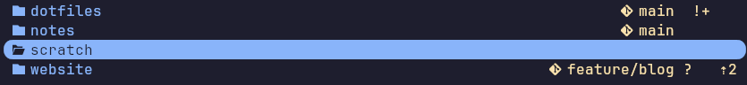

# repo-status.yazi

Show the branch and status of Git repositories next to their directory in the
file list, like a shell prompt does.

```
 dotfiles                      󰊢 main  !+
 notes                         󰊢 main
 website               󰊢 feature/blog ?   ⇡2
 scratch
```

[git.yazi](https://github.com/yazi-rs/plugins/tree/main/git.yazi) marks the
changed files _inside_ the repository you are browsing. This plugin covers the
other case: a directory full of repositories, where you want to see at a glance
which ones are dirty, ahead or behind. The two work side by side.



## Requirements

- [Yazi](https://github.com/sxyazi/yazi) 26.8.15 or later
- `git`
- A [Nerd Font](https://www.nerdfonts.com/) for the default branch icon (or set
  your own `icon`)

## Installation

```sh
ya pkg add ThomasVanRiel/repo-status
```

## Setup

Add the following to your `~/.config/yazi/init.lua`:

```lua
require("repo-status"):setup()
```

And register it as a fetcher in your `~/.config/yazi/yazi.toml`:

```toml
[[plugin.prepend_fetchers]]
url   = "*/"
run   = "repo-status"
group = "repo-status"
```

## What is shown

The branch name (or the short commit hash when `HEAD` is detached), followed by
one sign per status that applies and the number of commits ahead of or behind
the upstream branch. The defaults match the
[starship](https://starship.rs/config/#git-status) prompt:

| Sign | Meaning                                  | Option       |
| ---- | ---------------------------------------- | ------------ |
| `=`  | Merge conflicts                          | `conflicted` |
| `?`  | Untracked files                          | `untracked`  |
| `$`  | Stashed changes                          | `stashed`    |
| `!`  | Modified files in the working tree       | `modified`   |
| `+`  | Staged changes                           | `staged`     |
| `»`  | Staged renames                           | `renamed`    |
| `✘`  | Deleted files                            | `deleted`    |
| `⇡n` | `n` commits ahead of upstream            | `ahead`      |
| `⇣n` | `n` commits behind upstream              | `behind`     |
| `⇕`  | Prefix when both ahead and behind        | `diverged`   |

A clean repository shows only its branch. Directories that are not
repositories show nothing.

## Options

All options are optional; these are the defaults:

```lua
require("repo-status"):setup {
	-- Order of the summary in the linemode (git.yazi uses 1500)
	order = 1400,
	-- Style of the summary
	style = ui.Style():fg("yellow"),
	-- Text shown before the branch name
	icon = "󰊢 ",
	-- Give every sign its own column, see "Alignment"
	align = true,
	-- Sign per status; set one to "" to hide that status
	signs = {
		conflicted = "=",
		untracked = "?",
		stashed = "$",
		modified = "!",
		staged = "+",
		renamed = "»",
		deleted = "✘",
		ahead = "⇡",
		behind = "⇣",
		diverged = "⇕",
	},
}
```

You only need to pass the signs you want to change:

```lua
require("repo-status"):setup {
	style = ui.Style():fg("blue"):bold(),
	icon = " ",
	signs = { stashed = "", modified = "*" },
}
```

## Alignment

Every sign gets its own column, which is left empty for the repositories it
does not apply to, so the branch names all end in the same column. Space is
only reserved for the signs that at least one repository in the directory
shows, and the ahead and behind columns are as wide as their largest count.

With `align = false` the summary is as short as possible instead, and the
signs end up wherever the branch name stops:

```
 dotfiles                         󰊢 main !+
 notes                               󰊢 main
 website                 󰊢 feature/blog ? ⇡2
 scratch
```

A directory with only clean repositories looks the same either way.

## Notes

- The summary is part of the linemode, so it is right-aligned and only shown in
  the current (middle) pane. On the hovered row it takes the hover style
  instead of its own colour, like git.yazi's signs.
- One `git status` runs per repository directory in view, in the background.
  Statuses refresh when Yazi fetches the directory again (for example when you
  re-enter it), not continuously.
- Worktrees and submodules (a `.git` file instead of a directory) are
  recognised.

## Disclaimer

This plugin, including its documentation, was developed with the assistance of
an LLM (Claude). Please report anything that looks wrong in an issue.

## License

MIT
